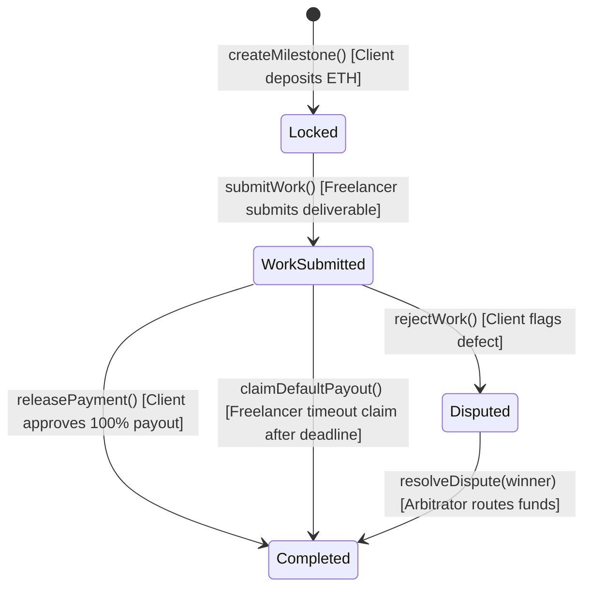

# ClearEscrow — Decentralized Escrow Demo & Freelancer Marketplace

A high-performance Web3 alternative to Upwork and Fiverr built on **Arbitrum Sepolia Layer-2** with a persistent local marketplace and genuine browser push notifications.

---

## 1. Key Value Proposition & Architecture
- **0% Platform Take-Rate:** Freelancers retain 100% of their earnings upon milestone approval.
- **>99% Gas Savings:** Arbitrum Sepolia Nitro rollup transactions average ~$0.03 with sub-second (~0.25s) latency.
- **Ghosting Protection:** Automated smart-contract timeout release (`claimDefaultPayout`) allows freelancers to claim locked escrow funds if a client becomes inactive after work is submitted.
- **Embedded Persistent Storage:** Zero-dependency embedded SQLite (`node:sqlite`) for jobs, proposals, and subscriptions with WAL mode enabled.
- **Cryptographic Wallet Identity:** Challenge-response nonce signatures (EIP-191 via `viem`) ensure verified wallet ownership without treating arbitrary client-supplied addresses as trusted.
- **Genuine Web Push Notifications:** VAPID-authenticated browser push delivery using standard Push API & Service Worker (`public/sw.js`) alongside an in-app notification center.

---

## 2. Escrow State Machine Architecture

The Solidity contract [`contracts/Escrow.sol`](contracts/Escrow.sol) enforces strict state transitions on Arbitrum Sepolia:



---

## 3. Marketplace & Workflow Guide

### A. Client Workflow (Hiring & Funding)
1. Navigate to **Client Portal** (`/client`) or click **Post a Job** on the homepage.
2. Fill out work opportunity details: Title, description, required skill tags, budget in ETH, application deadline, and completion deadline.
3. Click **Publish Job & Alert Freelancers**. The posting is committed to persistent storage, and subscribed freelancers receive an instant Web Push notification.
4. When freelancers submit proposals, open **My Posted Jobs & Applicants** or the Job Details page (`/jobs/[id]`).
5. Review competing proposals, rates, and turnaround estimates. Click **Select Candidate** to assign the job and automatically reject other bids.
6. Click **Fund Escrow for Candidate** to open the milestone escrow form pre-filled with the candidate's address and agreed budget.

### B. Freelancer Workflow (Browsing & Working)
1. Navigate to **Freelancer Portal** (`/freelancer`) or **Marketplace** (`/jobs`).
2. Search and filter available work opportunities by skill tags (`Solidity`, `React`, `TypeScript`, etc.).
3. Open any job to review full specifications. Click **Apply for this Opportunity**, provide your proposal statement, bid, and estimated turnaround days.
4. Sign the one-time cryptographic challenge via MetaMask to authenticate your identity.
5. In **Profile & Preferences**, toggle **Job Push Alerts** to subscribe your browser to instant Web Push notifications whenever new opportunities are published.
6. Once selected and the client funds the escrow, look up the milestone ID under **Deliver Work & Escrow** to submit deliverables and claim auto-release if the client ghosts.

---

## 4. Setup & Local Launch Instructions

### Prerequisites
- Node.js `v22.5.0` or higher (Node `v24.x` recommended for native `node:sqlite`).
- MetaMask browser extension connected to **Arbitrum Sepolia Testnet** (`Chain ID: 421614`).

### Step 1: Install Dependencies
```bash
# In repository root
npm install

# In frontend directory
cd frontend
npm install
cd ..
```

### Step 2: Environment Configuration
Copy the template configuration in `frontend/.env.example` to `frontend/.env.local`:
```bash
cp frontend/.env.example frontend/.env.local
```

The template includes:
```ini
# Server-side VAPID Keys for Web Push Notifications
NEXT_PUBLIC_VAPID_PUBLIC_KEY="<Your Public VAPID Key>"
VAPID_PRIVATE_KEY="<Your Private VAPID Key>"
VAPID_SUBJECT="mailto:admin@clearescrow.local"

# Authentication HMAC Secret
AUTH_SECRET="<Random Secret String>"

# Arbitrum Sepolia RPC & Contract Address
NEXT_PUBLIC_RPC_URL="https://sepolia-rollup.arbitrum.io/rpc"
NEXT_PUBLIC_ESCROW_CONTRACT_ADDRESS="0xAbc85afeC52cf3C8371e54dB11Fe28129DE9F824"
```

*Note: Pre-generated local development VAPID keys are already populated in `frontend/.env.local`.*

### Step 3: Run Automated Tests
Execute the full test suite (smart contract escrow logic + marketplace backend integration):
```bash
npm test
```

Expected output:
```text
✔ Escrow Smart Contract Automated Tests (6 passed)
✔ Marketplace Backend & Storage Tests (7 passed)
Total: 13 passed, 0 failed
```

### Step 4: Launch the Frontend

#### Running on macOS (Quick Launch)
To run the frontend directly on macOS:

```bash
cd "/Users/riteshdebnath/BLOCKCHAIN ENHANCED/frontend" && npm run dev
```

1. Open **Terminal** on macOS.
2. Copy and paste the command above and press **Enter**.
3. Wait until Next.js displays `"Ready"`.
4. Open [http://localhost:3000](http://localhost:3000) in a browser.
5. Keep the Terminal window open while using the local website.
6. Press **Ctrl+C** in Terminal to stop the development server when finished.

#### Running on Other Machines / Repositories
For other developers who clone the repository, run the following portable commands from the project root (make sure dependencies are installed first with `npm install` if they are not already installed):

```bash
cd frontend
npm install
npm run dev
```

Open [http://localhost:3000](http://localhost:3000) in your browser.

---

## 5. Security & Verification Summary
- **No Spoofed Addresses:** Profile modifications, job creations, applications, and candidate selections require valid cryptographic signatures verified via `viem` (`verifyMessage`).
- **Duplicate Prevention:** Database unique constraints `UNIQUE(job_id, freelancer_address)` enforce strictly one application per freelancer per job.
- **Idempotent Notifications:** All in-app and push notification dispatches use deterministic `idempotency_key` records to prevent duplicate deliveries on retries.
- **Zero Secrets Committed:** All private keys and authentication secrets are kept strictly in `.env.local` which is excluded by `.gitignore`.
