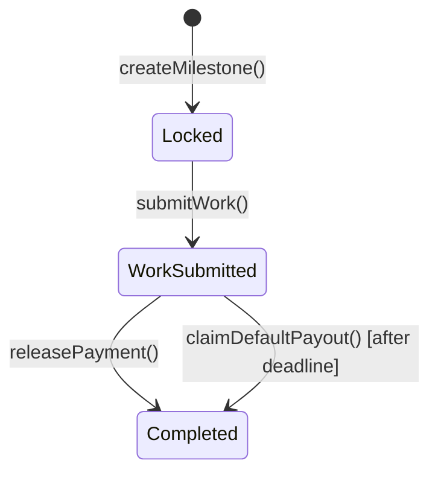

# Decentralized Escrow Demo

A high-performance Web2 alternative to Fiverr/Upwork built on Arbitrum Sepolia.

## Value Proposition
- **0% Platform Take-Rate**: Freelancers retain 100% of the payout.
- **>95% Gas Savings**: Built on Layer-2 Arbitrum Sepolia for ~$0.03 transactions and sub-second latency.
- **MetaMask-First Integration**: Designed for seamless browser wallet connectivity.
- **Ghosting Protection**: Automated timeout release allows freelancers to claim locked funds if clients fail to approve submitted work before the deadline.

## State Machine Architecture
The contract enforces strict transitions between milestones:
1. `Locked`: Client deposits funds, locked in the contract.
2. `WorkSubmitted`: Freelancer submits the completed work.
3. `Completed`: Client releases payment, OR freelancer triggers `Auto-Release` after the deadline.



## Setup & Launch Commands
```bash
# 1. Install dependencies
npm install

# 2. Compile smart contracts
npx hardhat compile

# 3. Deploy to Arbitrum Sepolia
npx hardhat run scripts/deploy.js --network arbitrumSepolia

# 4. Start the frontend
cd frontend
npm install
npm run dev
```
